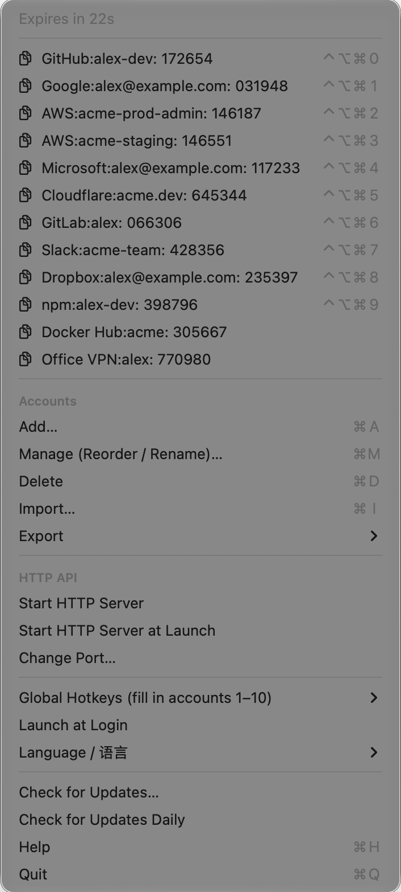
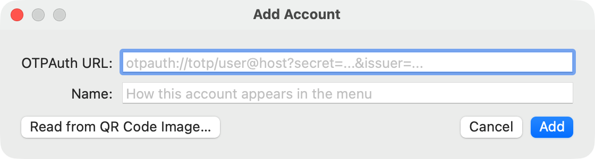
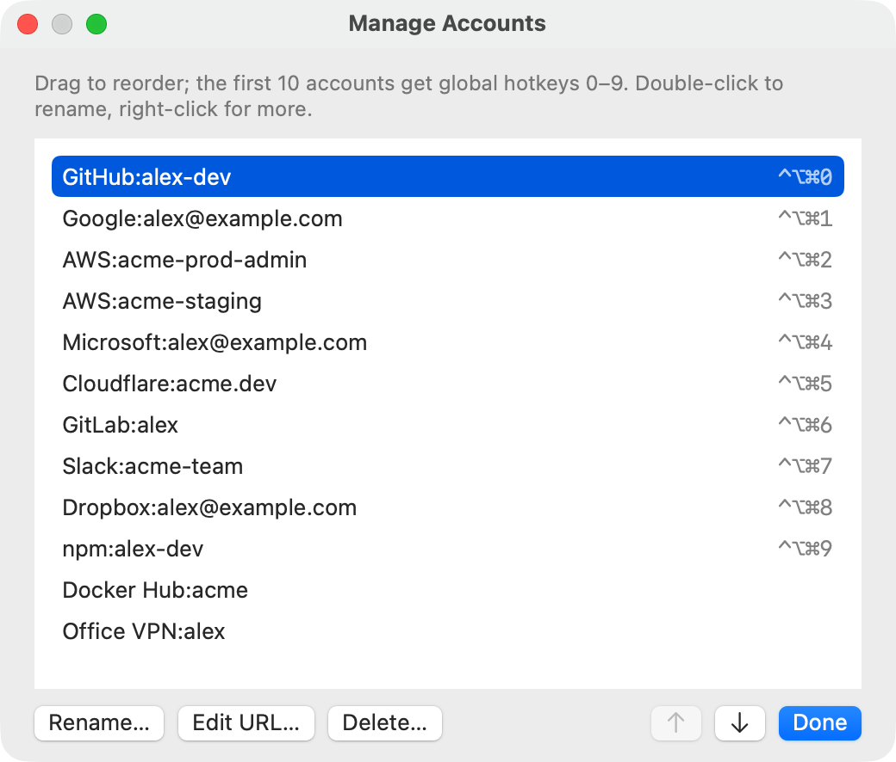
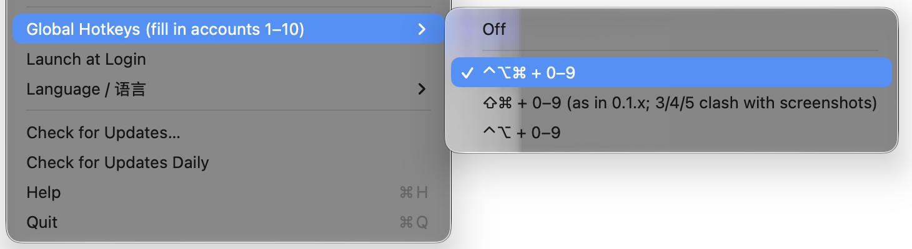
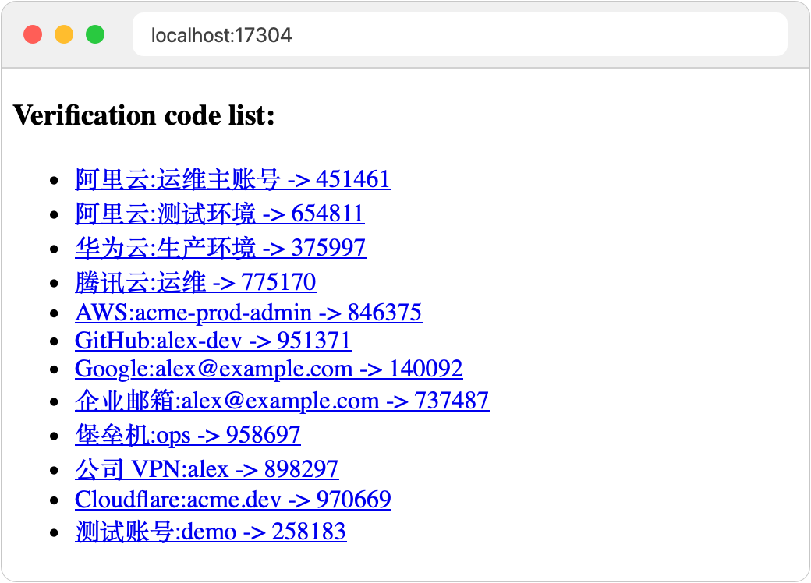

# GoldenPassport

English | [简体中文](README.zh-CN.md)

A native Google Authenticator for the macOS menu bar: TOTP codes one click (or one hotkey) away.

> **This is a maintained fork of [stanzhai/GoldenPassport](https://github.com/stanzhai/GoldenPassport).**
> The original project has been inactive since 2022 and its Homebrew cask was disabled in
> September 2026. Version 0.2.0 here is a ground-up rewrite for current macOS and a drop-in
> upgrade for 0.1.x users: same app, same bundle id, your existing accounts are migrated
> automatically. All credit for the original idea and design goes to
> [StanZhai](https://github.com/stanzhai).

- Runs natively on **Apple Silicon** and on Intel Macs, macOS 13 or later
- Signed with a Developer ID and notarized by Apple; no third-party dependencies
- English and Simplified Chinese interface: follows the system language, or pick one in the
  menu under Language / 语言

# Screenshots

- [Menu bar menu](#menu-bar-menu)
- [Adding an account](#adding-an-account)
- [Managing accounts](#managing-accounts)
- [Hotkey settings](#hotkey-settings)
- [Local HTTP API](#local-http-api)

### Menu bar menu

Click the key icon in the menu bar. The top line counts down until the codes change. Each account
is listed as `name: code`; click a row to copy its code. The first ten accounts show their global
hotkey on the right. Below the list are account management, the local HTTP API, hotkey settings,
launch at login and update checks.



### Adding an account

Choose **Add…** (⌘A) and paste an `otpauth://` URL, or pick a QR code image with
**Read from QR Code Image…**. The **Name** is filled in from the URL label; edit it before adding
if you like.



### Managing accounts

**Manage (Reorder / Rename)…** (⌘M) lists every account in menu order. Drag rows or use the arrow
buttons to reorder; the first ten rows show which hotkey they get. Double-click a row to rename it,
or right-click for **Rename…**, **Edit URL…** and **Delete…**; the same actions are available as
buttons at the bottom.



### Hotkey settings

The **Global Hotkeys** submenu sets the modifier keys used with 0–9: ⌃⌥⌘ (default), ⇧⌘ as in
0.1.x (3/4/5 clash with the system screenshot shortcuts), ⌃⌥, or **Off**. The checkmark shows the
current choice.



### Local HTTP API

With the HTTP API turned on, `http://localhost:17304/` lists every account with its current code.
Each entry links to `/code/<name>`, which returns just the code as plain text for use in scripts.
Chinese account names display correctly.



# What's new in 0.2.0

Compared with the original 0.1.7 release. The [changelog](CHANGELOG.md) lists the changes in every
release.

### New features

- **New app icon** in the macOS 26 style (a gold key with a person in its bow, after the original
  icon), with a matching menu bar icon that stays sharp at every size. macOS 13–15 show a flat
  version of it.
- **Codes follow the TOTP settings in the otpauth URL**: `algorithm` (SHA1, SHA256, SHA512),
  `digits` (6–8) and `period`. 0.1.x ignored them and always generated 6-digit SHA1 codes every
  30 seconds, so accounts with other settings got wrong codes.
- **English interface**: 0.1.x menus were in Chinese only. The interface follows the system
  language, or pick one in the menu under **Language / 语言**.
- **Manage window** (⌘M): drag or use the arrow buttons to reorder, double-click to rename,
  right-click to edit the URL or delete ([#12](https://github.com/stanzhai/GoldenPassport/issues/12), [#17](https://github.com/stanzhai/GoldenPassport/issues/17), [#29](https://github.com/stanzhai/GoldenPassport/issues/29)).
- **Configurable global hotkeys**: ⌃⌥⌘0–9 (new default), ⇧⌘0–9 (as in 0.1.x), ⌃⌥0–9, or off.
  Registered system-wide, so the keystroke no longer also reaches the frontmost app ([#4](https://github.com/stanzhai/GoldenPassport/issues/4), [#11](https://github.com/stanzhai/GoldenPassport/issues/11), [#18](https://github.com/stanzhai/GoldenPassport/issues/18)).
- **Export as an otpauth URL list** (`.txt`) that other authenticator apps can import; import
  accepts both this format and `.secrets` backups ([#10](https://github.com/stanzhai/GoldenPassport/issues/10), [#30](https://github.com/stanzhai/GoldenPassport/issues/30)).
- **Launch at login** toggle.
- **Update check**: **Check for Updates…** asks GitHub whether a newer release is out, and
  **Check for Updates Daily** does so once a day (off by default). If a release changes the data
  format or needs an intermediate upgrade first, the prompt says so before you install anything.
- The account name is suggested from the otpauth URL label, and pasted URLs are trimmed ([#26](https://github.com/stanzhai/GoldenPassport/issues/26)).
- **Installer with a safety net**: `install.sh` backs up the app and data, checks every migrated
  account and restores the previous app and data automatically if a check fails. `rollback.sh`
  puts back the previous app, and `cleanup.sh` deletes the unencrypted leftovers once you no
  longer need to roll back. Their messages follow the app's language.
- **Rolling back is a round trip**: accounts you add or change in 0.1.x after rolling back are
  listed when you upgrade again, and you choose which ones to import.

### Fixes

- Crashes when adding an account or reading a QR code image ([#1](https://github.com/stanzhai/GoldenPassport/issues/1), [#16](https://github.com/stanzhai/GoldenPassport/issues/16), [#21](https://github.com/stanzhai/GoldenPassport/issues/21), [#22](https://github.com/stanzhai/GoldenPassport/issues/22), [#25](https://github.com/stanzhai/GoldenPassport/issues/25), [#28](https://github.com/stanzhai/GoldenPassport/issues/28)).
  If you still see one, please [open an issue](https://github.com/thatscode/GoldenPassport/issues)
  with details.
- ⌘V / ⌘C / ⌘A now work in text fields ([#9](https://github.com/stanzhai/GoldenPassport/issues/9)).
- The HTTP index page declares UTF-8, so Chinese account names display correctly ([#26](https://github.com/stanzhai/GoldenPassport/issues/26)).
- Duplicate names are rejected instead of silently overwriting an existing account.
- Deleting an account asks for confirmation.
- The menu bar icon is visible to menu bar managers such as Bartender.

### Security & privacy

- Your accounts are kept in the **login Keychain** instead of a plaintext file. Other apps can't
  read them without macOS asking you first, and once the old data files are cleaned up, copies of
  the data folder (installer backups, sync tools, unencrypted Time Machine backups) no longer carry
  your secrets.
- Releases are **signed with a Developer ID and notarized by Apple**: they open without
  Gatekeeper workarounds, and updates from the same developer keep their access to the Keychain
  without asking again.
- The HTTP API is off on new installs. It has no password, so while it runs anything running as
  you on this Mac can read every code. Upgrades from 0.1.x keep their previous setting.
- GoldenPassport goes online only to check for updates, and only when you ask it to: choose
  **Check for Updates…**, or turn on **Check for Updates Daily** (off by default). The check asks
  GitHub's API for the latest release and, if it is newer, downloads a small compatibility file
  attached to it. Requests identify themselves only as `GoldenPassport/<version>` and carry no
  cookies or account information. New versions are never downloaded or installed automatically.
- The HTTP API listens on 127.0.0.1 only and rejects requests with a foreign `Host` header
  ([#6](https://github.com/stanzhai/GoldenPassport/issues/6)), so web pages cannot read your codes through DNS rebinding.
- Data files are owner-only: the data directory is `0700` and files are `0600`. 0.1.x left them
  readable by every local user; 0.2.0 tightens the existing files without changing them.
- Both export formats warn that the file contains every secret unencrypted.
- See [Data & security](#data--security) for every place a copy of your secrets can exist.

### Behaviour changes to be aware of

| | 0.1.x | 0.2.0 |
|---|---|---|
| Minimum macOS | 10.10 | **13** |
| Default hotkeys | ⇧⌘0–9 (3/4/5 clash with screenshots) | **⌃⌥⌘0–9**; ⇧⌘ is still available in the menu |
| Typing the code into the frontmost app | Accessibility permission | Still needs it, and it must be **granted again** after upgrading |
| HTTP API at launch | On unless you turned it off | **Off on new installs**; upgrades keep the 0.1.x setting |
| Where accounts are stored | `gp.secrets` | The login Keychain. Migrated automatically; `gp.secrets` is kept but no longer updated |
| Account order | Changed randomly between launches | Alphabetical after migration, then whatever order you set |

# Installation

Releases are signed with a Developer ID and notarized by Apple, so they open like any other
downloaded app.

> [!NOTE]
> The Homebrew cask (`brew install --cask goldenpassport`) still points to the old 0.1.7 and has
> been disabled by Homebrew. Bringing it back is on the [roadmap](#roadmap).

### Upgrading from 0.1.x, or installing fresh (recommended)

1. Download `GoldenPassport-<version>.zip` from the
   [latest release](https://github.com/thatscode/GoldenPassport/releases/latest) and unzip it.
   The folder holds the app, `install.sh`, `rollback.sh`, `cleanup.sh` and the install notes
   (`INSTALL.md`, `安装说明.md`).
2. In Terminal, type `bash ` (with a space after it), drag `install.sh` from the unzipped folder
   into the window and press Return.

To build it from source instead, see [Building](#building).

The installer:

1. checks the package and that your Mac and macOS version are supported;
2. backs up the current app and data to `~/GoldenPassport-backups/<timestamp>/`
   (⚠️ this contains your secrets unencrypted, see [Data & security](#data--security));
3. quits the running app and installs the new one to `/Applications`;
4. moves your accounts into the login Keychain and checks every entry against the file they came
   from (`gp.secrets`, or a 0.2.0 beta's `accounts.json`), printing account names only. **If
   anything does not match, it restores the previous app and data automatically**;
5. starts GoldenPassport.

After upgrading from 0.1.x or a 0.2.0 beta, grant **Accessibility** again if you want hotkeys to
type the code for you:
System Settings → Privacy & Security → Accessibility. If GoldenPassport is already listed but
typing doesn't work, remove it with "−" and pick a hotkey option in the menu again to get a
fresh prompt. Without the permission, hotkeys copy the code to the clipboard.

### Rolling back

Run `rollback.sh` the same way to put back the app you had before. 0.1.x and the 0.2.0 betas
don't use the Keychain: they see your accounts as they were when 0.2.0 moved them there
(`gp.secrets` itself is never modified). To take later changes along, export a `.secrets` backup
from 0.2.0 first and import it there.

When you upgrade again, 0.2.0 keeps using the accounts in the Keychain. Accounts you added or
changed in 0.1.x in the meantime are listed so you can choose which ones to import; nothing you
already have is overwritten or deleted, and an account whose URL changed is imported next to the
existing one as "name (0.1.x)". Changes made in a beta are not carried over; `cleanup.sh` lists
them before it deletes the beta's `accounts.json`.

`rollback.sh --restore-data` also resets the data folder to how it was before the install, and
the changes made in 0.2.0 are then lost: installing 0.2.0 again migrates from the restored files
and keeps the accounts that were in the Keychain only as a spare item, `accounts.replaced-<time>`.

### Cleaning up after the upgrade

Once 0.2.0 works for you and you no longer need to roll back, run `cleanup.sh` the same way. It
checks that your accounts read back from the Keychain and lists what it will delete: the installer
backups and the old data files (`gp.secrets`, a beta's `accounts.json`), which contain your
secrets unencrypted, along with the 0.1.x `config.plist`. It warns about accounts that exist only
in those files and deletes only after you type `yes`; after that you can no longer roll back.

The install notes in the package (`INSTALL.md`, also [online](docs/install.md)) cover installing,
rolling back and cleaning up step by step.

### Manual installation

Copy `GoldenPassport.app` to `/Applications` and open it. Your data is migrated on first launch,
but you get no backup and no migration check.

# Usage

Click the key icon in the menu bar. Each account shows its current code; click one to copy it.

| Menu item | What it does |
|---|---|
| Add… (⌘A) | Add an account from an otpauth URL or a QR code image |
| Manage (Reorder / Rename)… (⌘M) | Reorder, rename, edit or delete accounts |
| Delete (⌘D) | Delete an account (asks for confirmation) |
| Import… (⌘I) | Import a `.secrets` backup or an otpauth URL list; existing names are skipped |
| Export → Backup File (.secrets) | Backup readable by both 0.1.x and 0.2.x |
| Export → otpauth URL List (.txt) | One otpauth URL per account, for other authenticator apps |
| HTTP API | Start or stop the local API, start it at launch, open it in the browser, change the port |
| Global Hotkeys | Choose the modifier keys for the hotkeys, or turn them off |
| Launch at Login | Launch GoldenPassport at login |
| Language / 语言 | System Default, or always 简体中文 or English (restarts the app) |
| Check for Updates… | Ask GitHub now whether a newer release is out |
| Check for Updates Daily | Check once a day; a newer release appears at the top of the menu (off by default) |
| Help (⌘H) | Open this README on GitHub, in the language the menu is in |

### Global hotkeys

Modifier + **0** fills in the code of the **first** account in the list, modifier + **1** the
second, and so on up to **9** for the tenth. Reorder accounts in the manage window to choose which
ones get hotkeys.

### RESTful API

When enabled, GoldenPassport serves codes on `http://localhost:17304/` (the port can be changed
in the menu). It listens on 127.0.0.1 only. The API is off on new installs: turn it on with
**Start HTTP Server**, and check **Start HTTP Server at Launch** to start it with the app.

| Endpoint | Response |
|---|---|
| `GET /` | HTML page listing your accounts, linking to their codes |
| `GET /code/<account name>` | The current code as plain text; `404` if no account has that name |

```sh
code=$(curl -s 'http://localhost:17304/code/test@stanzhai.site')
echo "$code"
```

# Data & security

> [!CAUTION]
> **Upgrading leaves unencrypted copies of your MFA secrets on disk.**
>
> - **Installer backup**: `install.sh` copies the whole data directory to
>   `~/GoldenPassport-backups/<timestamp>/` so it can roll back. This is a plaintext copy of
>   every secret (owner-only permissions). Never share or sync it, and delete it once you no
>   longer need to roll back (`cleanup.sh`, see [Cleaning up](#cleaning-up-after-the-upgrade)).
> - **Legacy data file**: after migration, `gp.secrets` stays in the data directory so the
>   old app keeps working. It is never updated again, so **accounts you delete in 0.2.x
>   remain in it**. Delete it once you are sure you won't go back to 0.1.x (`cleanup.sh`).
> - **Beta data file**: after 0.2.0 moves your accounts into the Keychain, a beta's
>   `accounts.json` stays in the data directory, unencrypted, so that you can roll back. Delete it
>   with `cleanup.sh` once you won't go back to the beta.
> - **Exports**: both `.secrets` and `.txt` exports contain every secret unencrypted.

GoldenPassport keeps the account list in one item named **GoldenPassport** in your login
Keychain. It stays on this Mac (it is not synced through iCloud Keychain), and other apps that
ask for it get a macOS prompt first. The Keychain doesn't change the HTTP API or exports: while
the API runs, anything running as you can still read every code, and exports are still
unencrypted.

The data folder, `~/Library/Application Support/GoldenPassport/`, is readable only by you: 0.2.0
restricts it to `0700` and its files to `0600` (0.1.x left them readable by every local user).
Apart from the old data files listed above, it holds no secrets: `accounts-v2.json` only says that
the accounts are in the Keychain, `settings.json` holds your settings, and `legacy-baseline.json`
records which accounts `gp.secrets` held, as names and URL fingerprints without any secrets, so
that changes made in 0.1.x after a rollback can be found.

### If GoldenPassport can't read its data

If a data file can't be read (for example, it is damaged or was edited by hand), GoldenPassport
shows an alert that names the file and quits without changing any file. It does not start with an
empty list, because the next save would then overwrite your data. To recover, work in the data
folder (click Show in Finder in the alert, or open `~/Library/Application Support/GoldenPassport/`).

If the alert names **`accounts-v2.json`**, your accounts are still in the Keychain:

1. Rename `accounts-v2.json`, for example to `accounts-v2.damaged.json`.
2. Move `gp.secrets` and `accounts.json` out of the data folder for now, if they are there.
   Otherwise GoldenPassport would rebuild the list from those older files, and keep your current
   accounts only as a spare Keychain item (`accounts.replaced-<time>`).
3. Start GoldenPassport. It finds your accounts in the Keychain and writes a new
   `accounts-v2.json`. Put the files you moved back afterwards if you still want to be able to
   roll back.

If the alert names **`accounts.json`**, the data file of builds you make yourself and of the 0.2.0
betas:

1. **Keep the damaged file**: rename it, for example to `accounts.damaged.json`. Don't delete it.
2. **If you have a backup of `accounts.json`**, copy it back into the data folder and start
   GoldenPassport. Backups can come from Time Machine, or from
   `~/GoldenPassport-backups/<timestamp>/data/` if you ran `install.sh` while 0.2.x was already
   installed; that copy holds your accounts as they were at that install.
3. **If you only have an export** (`.secrets` or `.txt`): if `gp.secrets` is in the data folder,
   move it out for now as well. Start GoldenPassport, which now starts with an empty list, and
   import the export. Put `gp.secrets` back afterwards if you still want to be able to roll back
   to 0.1.x. Without this step, GoldenPassport would first rebuild the list from `gp.secrets` (your
   accounts as they were when you upgraded from 0.1.x), and the import would skip every name that
   already exists, keeping those older entries.
4. **If you have neither**, but `gp.secrets` is in the data folder: start GoldenPassport after
   step 1. It rebuilds the list from `gp.secrets`, as it was when you upgraded from 0.1.x; accounts
   added or changed since then can't be recovered this way.

If the alert names `gp.secrets` instead, the 0.1.x data file is damaged and its accounts can't be
migrated. Move it out of the data folder, then restore your accounts from a backup or an export
as above.

#### If your accounts in the Keychain can't be read

The alert says why, and nothing is changed:

- **Access was denied**: you clicked Deny when macOS asked. Click Retry and choose Always Allow.
  macOS asks again after an update signed by a different developer.
- **The keychain is locked**: unlock the login keychain in Keychain Access, then click Retry.
- **The item is missing**, because it was deleted in Keychain Access or only the data folder was
  copied to this Mac: if the data folder still has `accounts.json` or `gp.secrets`, GoldenPassport
  offers to migrate again from it. That file holds your accounts as they were before they moved
  to the Keychain, so import a newer export afterwards if you have one. Without such a file it
  offers to start with an empty list, so that you can import an export; or quit and restore your
  login keychain from a backup.
- **The data comes from a newer version**: install that version again.

When a migration finds an earlier GoldenPassport item in the Keychain, for example after
`rollback.sh --restore-data`, it keeps that item as `accounts.replaced-<time>` instead of
overwriting it. Delete those items in Keychain Access once you no longer need them.

When asking for help in an [issue](https://github.com/thatscode/GoldenPassport/issues), include
the alert text, but **never attach the data files**: they contain your secrets.

To report a security problem, please don't open a public issue: use
[Report a vulnerability](https://github.com/thatscode/GoldenPassport/security/advisories/new) to
tell the maintainers privately.

# Building

Requires Xcode 16 or later. No third-party dependencies.

```
make test      # unit tests
make dev       # "GoldenPassport Dev.app": own bundle id, data folder and port 17305, hotkeys off
make run-dev   # build and launch the Dev app
make release   # "GoldenPassport.app", a drop-in replacement for the installed app
make package   # universal app + install/rollback/cleanup scripts + install notes, zipped under dist/
make beta      # the same, labelled as a pre-release
```

Apps are written to `~/Library/Caches/GoldenPassport-build/<variant>/`. They are ad-hoc signed
with the hardened runtime and keep the accounts in `accounts.json` in the data folder,
unencrypted: macOS treats every ad-hoc build as a new app and would ask for Keychain access after
each update. `SIGN_IDENTITY="Developer ID Application: …"` signs with a certificate and turns on
the Keychain storage (`KEYCHAIN=1` does so on its own); with `make package`, `NOTARIZE=1` also
notarizes the app and staples the ticket (`scripts/notarize.sh`). `ARCHS="arm64 x86_64"` builds a
universal binary.

On first launch, the Dev build copies the 0.1.x data (`gp.secrets`, `config.plist`) from the
release data folder into `GoldenPassport-Dev/`, if it is there. It never writes to the release data
folder, so it can run next to the installed app. The copy holds your secrets in plain text: delete
`GoldenPassport-Dev/` when you are done. `GoldenPassport --migrate-data [--data-dir PATH]` runs the
data migration without the user interface and checks the result; `install.sh` relies on it.
`GP_KEYCHAIN_TESTS=1 make test` also runs the tests that use the real login Keychain, with a
throwaway item.

# Roadmap

- Bring the Homebrew cask back

# Credits & license

GoldenPassport was created by [StanZhai](https://github.com/stanzhai) in 2017. This fork is
maintained by [thatscode](https://github.com/thatscode).

Released under the [MIT License](LICENSE), inherited from the original project
([stanzhai/GoldenPassport#33](https://github.com/stanzhai/GoldenPassport/issues/33)), whose
repository is now archived.

# Resources

- [RFC 6238: TOTP](https://www.rfc-editor.org/rfc/rfc6238)
- [Key URI format (otpauth://)](https://github.com/google/google-authenticator/wiki/Key-Uri-Format)
- [google-authenticator](https://github.com/google/google-authenticator)
