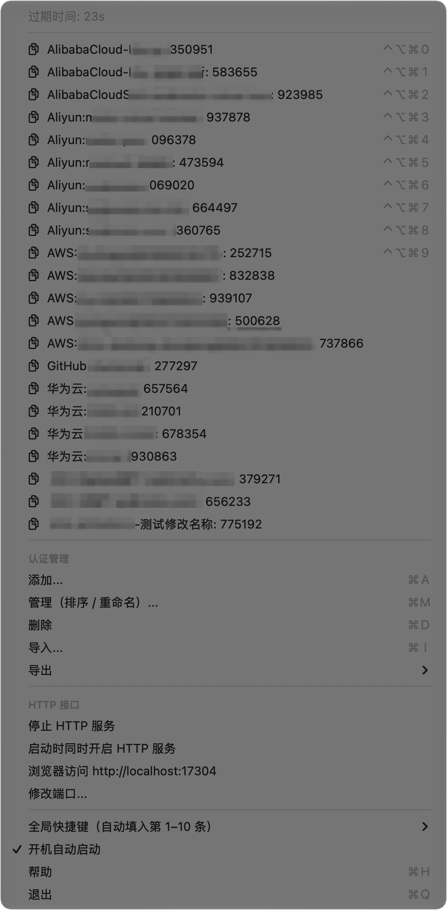
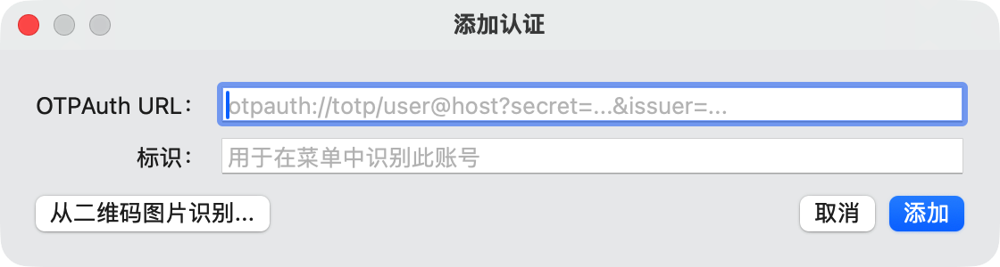
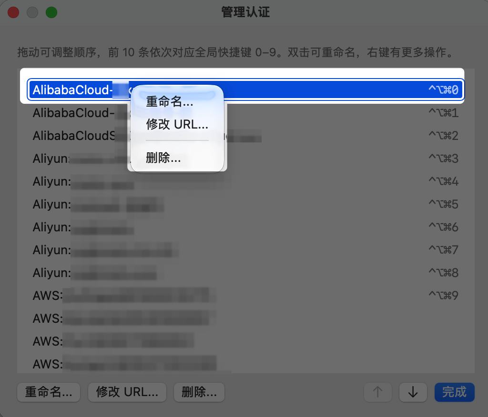
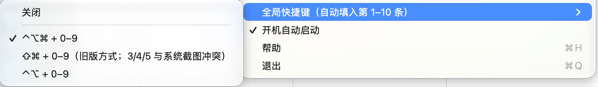
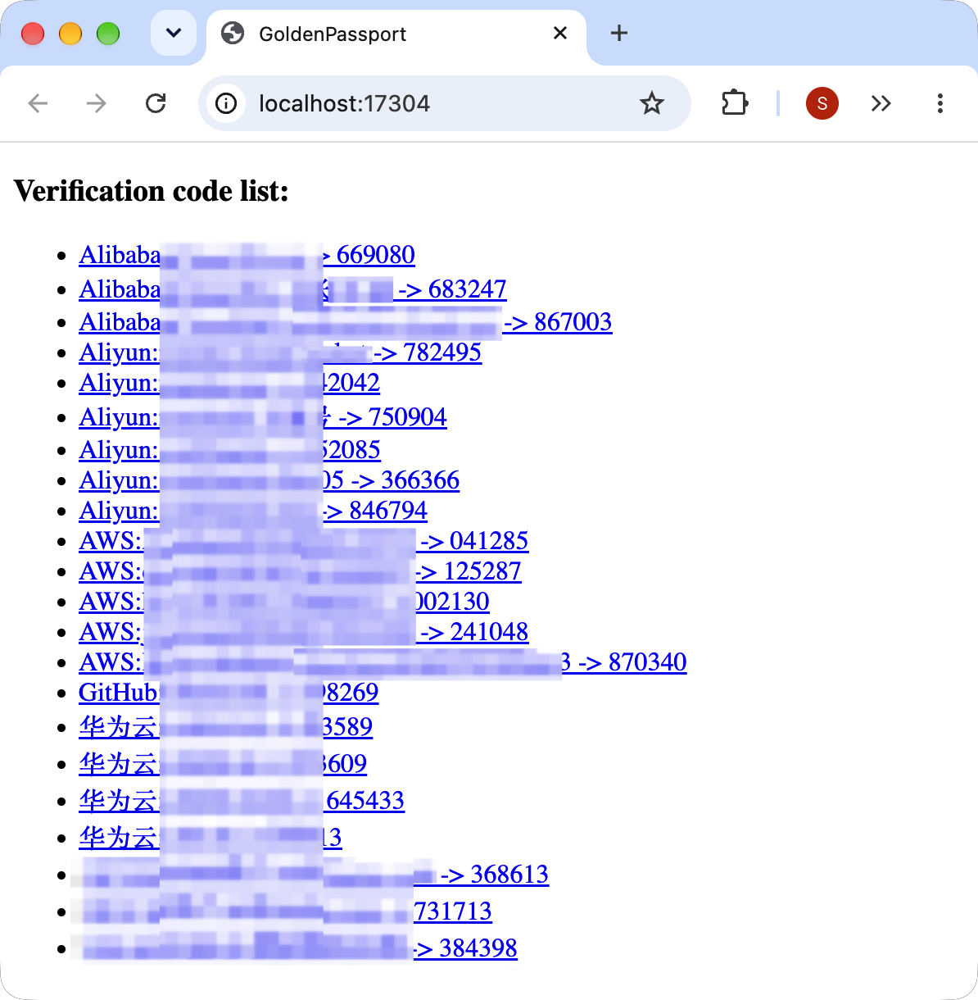

# GoldenPassport

English | [简体中文](README.zh-CN.md)

A native Google Authenticator for the macOS menu bar: TOTP codes one click (or one hotkey) away.

> **This is a maintained fork of [stanzhai/GoldenPassport](https://github.com/stanzhai/GoldenPassport).**
> The original project has been inactive since 2022 and its Homebrew cask was disabled in
> September 2026. Version 0.2.0 here is a ground-up rewrite for current macOS and a drop-in
> upgrade for 0.1.x users: same app, same bundle id, your existing accounts are migrated
> automatically. All credit for the original idea and design goes to
> [StanZhai](https://github.com/stanzhai).

- Native Swift, **Apple Silicon native** (universal builds also run on Intel), macOS 13 or later
- No third-party dependencies
- English and Simplified Chinese interface: follows the system language, or pick one in the
  menu under Language / 语言

# Screenshots

- [Menu bar menu](#menu-bar-menu)
- [Adding an account](#adding-an-account)
- [Managing accounts](#managing-accounts)
- [Hotkey settings](#hotkey-settings)
- [Local HTTP API](#local-http-api)

### Menu bar menu

Click the key icon in the menu bar. The top line counts down until the codes change. Each account
is listed as `name: code`; click a row to copy its code. The first ten accounts show their global
hotkey on the right. Below the list are account management, the local HTTP API, hotkey settings,
launch at login and update checks.

<!-- SCREENSHOT screenshot/en/menu.png: the menu in the English UI with a few made-up accounts,
     showing the Language / 语言, Check for Updates… and Check for Updates Daily items. Replace the
     Chinese screenshot below with it. -->


### Adding an account

Choose **Add…** (⌘A) and paste an `otpauth://` URL, or pick a QR code image with
**Read from QR Code Image…**. The **Name** is filled in from the URL label; edit it before adding
if you like.

<!-- SCREENSHOT screenshot/en/add-window.png: the Add Account window in the English UI. Replace
     the Chinese screenshot below with it. -->


### Managing accounts

**Manage (Reorder / Rename)…** (⌘M) lists every account in menu order. Drag rows or use the arrow
buttons to reorder; the first ten rows show which hotkey they get. Double-click a row to rename it,
or right-click for **Rename…**, **Edit URL…** and **Delete…**; the same actions are available as
buttons at the bottom.

<!-- SCREENSHOT screenshot/en/manage-window.png: the Manage Accounts window in the English UI.
     Replace the Chinese screenshot below with it. -->


### Hotkey settings

The **Global Hotkeys** submenu sets the modifier keys used with 0–9: ⌃⌥⌘ (default), ⇧⌘ as in
0.1.x (3/4/5 clash with the system screenshot shortcuts), ⌃⌥, or **Off**. The checkmark shows the
current choice.

<!-- SCREENSHOT screenshot/en/hotkeys.png: the Global Hotkeys submenu in the English UI. Replace
     the Chinese screenshot below with it. -->


### Local HTTP API

With the HTTP API turned on, `http://localhost:17304/` lists every account with its current code.
Each entry links to `/code/<name>`, which returns just the code as plain text for use in scripts.
Chinese account names display correctly.



# What's new in 0.2.0

Compared with the original 0.1.7 release.

### Rewritten from scratch

- Swift Package instead of an Xcode project with CocoaPods; the Objective-C one-time-password
  code, the bundled google-toolbox-for-mac sources and the Swifter HTTP server are all gone.
- TOTP is implemented with CryptoKit and honours `algorithm`, `digits` and `period` from the
  otpauth URL (SHA1 / SHA256 / SHA512, 6–8 digits), verified against the RFC 6238 test vectors.
- Accounts are stored as an ordered list (`accounts.json`) instead of a dictionary whose order
  changed on every launch.
- 78 unit tests cover TOTP, URL parsing, storage, migration, the HTTP API, the update check and
  the translations.

### New features

- **English interface**: 0.1.x menus were in Chinese only. The interface follows the system
  language, or pick one in the menu under **Language / 语言**.
- **Manage window** (⌘M): drag or use the arrow buttons to reorder, double-click to rename,
  right-click to edit the URL or delete ([#12](https://github.com/stanzhai/GoldenPassport/issues/12), [#17](https://github.com/stanzhai/GoldenPassport/issues/17), [#29](https://github.com/stanzhai/GoldenPassport/issues/29)).
- **Configurable global hotkeys**: ⌃⌥⌘0–9 (new default), ⇧⌘0–9 (as in 0.1.x), ⌃⌥0–9, or off.
  Registered system-wide, so the keystroke no longer also reaches the frontmost app ([#4](https://github.com/stanzhai/GoldenPassport/issues/4), [#11](https://github.com/stanzhai/GoldenPassport/issues/11), [#18](https://github.com/stanzhai/GoldenPassport/issues/18)).
- **Export as an otpauth URL list** (`.txt`) that other authenticator apps can import; import
  accepts both this format and `.secrets` backups ([#10](https://github.com/stanzhai/GoldenPassport/issues/10), [#30](https://github.com/stanzhai/GoldenPassport/issues/30)).
- **Launch at login** toggle.
- **Update check**: **Check for Updates…** asks GitHub whether a newer release is out, and
  **Check for Updates Daily** does so once a day (off by default). If a release changes the data format or needs an
  intermediate upgrade first, the prompt says so before you install anything.
- The account name is suggested from the otpauth URL label, and pasted URLs are trimmed ([#26](https://github.com/stanzhai/GoldenPassport/issues/26)).
- **Installer with a safety net**: `install.sh` backs up the app and data, checks every migrated
  account and restores the previous app and data automatically if a check fails. `rollback.sh`
  puts back the previous app, and `cleanup.sh` deletes the unencrypted leftovers once you no
  longer need to roll back. Their messages follow the app's language.
- **Rolling back is a round trip**: accounts you add or change in 0.1.x after rolling back are
  listed when you upgrade again, and you choose which ones to import.

### Fixes

- Crashes when adding an account or reading a QR code image ([#1](https://github.com/stanzhai/GoldenPassport/issues/1), [#16](https://github.com/stanzhai/GoldenPassport/issues/16), [#21](https://github.com/stanzhai/GoldenPassport/issues/21), [#22](https://github.com/stanzhai/GoldenPassport/issues/22), [#25](https://github.com/stanzhai/GoldenPassport/issues/25), [#28](https://github.com/stanzhai/GoldenPassport/issues/28)).
  If you still see one, please [open an issue](https://github.com/thatscode/GoldenPassport/issues)
  with details.
- ⌘V / ⌘C / ⌘A now work in text fields ([#9](https://github.com/stanzhai/GoldenPassport/issues/9)).
- The HTTP index page declares UTF-8, so Chinese account names display correctly ([#26](https://github.com/stanzhai/GoldenPassport/issues/26)).
- Duplicate names are rejected instead of silently overwriting an existing account.
- Deleting an account asks for confirmation.
- The menu bar icon is visible to menu bar managers such as Bartender.

### Security & privacy

- The HTTP API is off on new installs. It has no password, so while it runs anything running as
  you on this Mac can read every code. Upgrades from 0.1.x keep their previous setting.
- GoldenPassport goes online only to check for updates, and only when you ask it to: choose
  **Check for Updates…**, or turn on **Check for Updates Daily** (off by default). The check asks GitHub's API for the
  latest release and, if it is newer, downloads that release's small `compat.json`. Requests
  identify themselves only as `GoldenPassport/<version>` and carry no cookies or account
  information. Nothing is downloaded or installed automatically.
- The HTTP API listens on 127.0.0.1 only and rejects requests with a foreign `Host` header
  ([#6](https://github.com/stanzhai/GoldenPassport/issues/6)), so web pages cannot read your codes through DNS rebinding.
- Data files are owner-only: the data directory is `0700` and files are `0600`. 0.1.x left them
  readable by every local user; 0.2.0 tightens the existing files without changing them.
- Both export formats warn that the file contains every secret unencrypted.
- See [Data & security](#data--security) for every place a copy of your secrets can exist.

### Behaviour changes to be aware of

| | 0.1.x | 0.2.0 |
|---|---|---|
| Minimum macOS | 10.10 | **13** |
| Default hotkeys | ⇧⌘0–9 (3/4/5 clash with screenshots) | **⌃⌥⌘0–9**; ⇧⌘ is still available in the menu |
| Typing the code into the frontmost app | Accessibility permission | Still needs it, and it must be **granted again** after upgrading |
| HTTP API at launch | On unless you turned it off | **Off on new installs**; upgrades keep the 0.1.x setting |
| Data file | `gp.secrets` | `accounts.json` (migrated automatically on first launch; `gp.secrets` is kept but no longer updated) |
| Account order | Changed randomly between launches | Alphabetical after migration, then whatever order you set |

# Installation

> [!IMPORTANT]
> **No release has been published yet.** The first release will follow once builds are notarized
> by Apple. Until then, build the package from source as shown below; it is the same
> package a release will contain.

> [!NOTE]
> Builds are **not yet notarized by Apple**, so macOS blocks them when opened from a download.
> The installer below handles this for you. Notarized releases and the Homebrew cask are on the
> [roadmap](#roadmap). `brew install --cask goldenpassport` installs the old 0.1.7 and is
> currently disabled by Homebrew.

### Upgrading from 0.1.x, or installing fresh (recommended)

1. Build the package (requires Xcode 16 or later, see [Building](#building)):
   ```sh
   git clone https://github.com/thatscode/GoldenPassport.git
   cd GoldenPassport
   make beta
   ```
   This creates `~/Library/Caches/GoldenPassport-build/dist/GoldenPassport-<version>-beta.zip`
   containing the app, `install.sh`, `rollback.sh` and `cleanup.sh`. Unzip it.
   (Once releases are published, download `GoldenPassport-<version>.zip` from the
   [releases](https://github.com/thatscode/GoldenPassport/releases) page instead.)
2. In Terminal, run `bash `, drag `install.sh` from the unzipped folder into the window and
   press Return.

The installer:

1. checks the package and that your Mac and macOS version are supported;
2. backs up the current app and data to `~/GoldenPassport-backups/<timestamp>/`
   (⚠️ this contains your secrets unencrypted, see [Data & security](#data--security));
3. quits the running app and installs the new one to `/Applications`;
4. migrates your accounts and checks every entry against `gp.secrets`, printing account names
   only. **If anything does not match, it restores the previous app and data automatically**;
5. starts GoldenPassport.

<!-- SCREENSHOT install.png: Terminal after a successful install.sh run in English, showing the
     "Migrated N accounts from 0.1.x; every entry matches gp.secrets" line and the warning box.
     Crop out your username/paths if you prefer. -->
<!--  -->

After upgrading, grant **Accessibility** again if you want hotkeys to type the code for you:
System Settings → Privacy & Security → Accessibility. If GoldenPassport is already listed but
typing doesn't work, remove it with "−" and pick a hotkey option in the menu again to get a
fresh prompt. Without the permission, hotkeys copy the code to the clipboard.

### Rolling back

Run `bash rollback.sh` from the same folder. It restores the app that was installed before; your
original `gp.secrets` was never modified, so 0.1.x finds all its accounts. Accounts you added
or changed in 0.2.0 are not visible to 0.1.x. To keep them, first export a `.secrets` backup
from 0.2.0 and import it into 0.1.x. `bash rollback.sh --restore-data` also resets the data
directory to its pre-install state. After an upgrade from an earlier 0.2.x build, `rollback.sh`
restores that build instead; it uses the same `accounts.json`, so all your accounts stay as they are.

Accounts you add or change in 0.1.x after rolling back are not lost when you upgrade again:
GoldenPassport lists what 0.1.x added, changed or deleted and lets you choose which accounts to
import. It never overwrites or deletes the accounts you already have in 0.2.0; an account whose
URL changed in 0.1.x is imported next to the existing one as "name (0.1.x)".

### Cleaning up after the upgrade

Once 0.2.0 works for you and you no longer need to roll back, run `bash cleanup.sh` from the same
folder. It checks that `accounts.json` reads back cleanly, lists what it will delete (the installer
backups and the legacy `gp.secrets` / `config.plist`, all of which contain your secrets
unencrypted), warns if 0.2.0 holds fewer accounts than the legacy file or if accounts changed in
0.1.x after a rollback haven't been imported yet (those files hold their only copies), and deletes
only after you type `yes`. After that, rolling back to 0.1.x is no longer possible.

### Manual installation

Copy `GoldenPassport.app` to `/Applications`, then either run
`xattr -dr com.apple.quarantine /Applications/GoldenPassport.app` or open it once and choose
"Open Anyway" in System Settings → Privacy & Security. Your data is migrated on first launch,
but you get no backup and no migration check.

# Usage

Click the key icon in the menu bar. Each account shows its current code; click one to copy it.

| Menu item | What it does |
|---|---|
| Add… (⌘A) | Add an account from an otpauth URL or a QR code image |
| Manage (Reorder / Rename)… (⌘M) | Reorder, rename, edit or delete accounts |
| Delete (⌘D) | Delete an account (asks for confirmation) |
| Import… (⌘I) | Import a `.secrets` backup or an otpauth URL list; existing names are skipped |
| Export → Backup File (.secrets) | Backup readable by both 0.1.x and 0.2.x |
| Export → otpauth URL List (.txt) | One otpauth URL per account, for other authenticator apps |
| HTTP API | Start or stop the local API, start it at launch, open it in the browser, change the port |
| Global Hotkeys | Choose the modifier keys for the hotkeys, or turn them off |
| Launch at Login | Launch GoldenPassport at login |
| Language / 语言 | System Default, or always 简体中文 or English (restarts the app) |
| Check for Updates… | Ask GitHub now whether a newer release is out |
| Check for Updates Daily | Check once a day; a newer release appears at the top of the menu (off by default) |
| Help (⌘H) | Open this README on GitHub, in the language the menu is in |

### Global hotkeys

Modifier + **0** fills in the code of the **first** account in the list, modifier + **1** the
second, and so on up to **9** for the tenth. Reorder accounts in the manage window to choose which
ones get hotkeys.

### RESTful API

When enabled, GoldenPassport serves codes on `http://localhost:17304/` (the port can be changed
in the menu). It listens on 127.0.0.1 only. The API is off on new installs: turn it on with
**Start HTTP Server**, and check **Start HTTP Server at Launch** to start it with the app.

| Endpoint | Response |
|---|---|
| `GET /` | HTML page listing your accounts, linking to their codes |
| `GET /code/<account name>` | The current code as plain text; `404` if no account has that name |

```sh
code=$(curl -s 'http://localhost:17304/code/test@stanzhai.site')
echo "$code"
```

# Data & security

> [!CAUTION]
> **Upgrading from 0.1.x leaves unencrypted copies of your MFA secrets on disk.**
>
> - **Installer backup**: `scripts/install.sh` copies the whole data directory to
>   `~/GoldenPassport-backups/<timestamp>/` so it can roll back. This is a plaintext copy of
>   every secret (owner-only permissions). Never share or sync it, and delete it once you no
>   longer need to roll back (`scripts/cleanup.sh`, see below).
> - **Legacy data file**: after migration, `gp.secrets` stays in the data directory so the
>   old app keeps working. It is never updated again, so **accounts you delete in 0.2.x
>   remain in it**. Delete it once you are sure you won't go back to 0.1.x (`scripts/cleanup.sh`).
> - **Exports**: both `.secrets` and `.txt` exports contain every secret unencrypted.
> - **Dev build**: `make dev` copies the release data into `GoldenPassport-Dev/` on first
>   launch; delete that directory when you are done developing.

All data lives in `~/Library/Application Support/GoldenPassport/` (`accounts.json`,
`settings.json`, plus the legacy `gp.secrets` / `config.plist`). Secrets are stored
unencrypted, protected only by file permissions: 0.2.x restricts the directory to `0700`
and its files to `0600` (0.1.x left them readable by every local user). After an upgrade from
0.1.x, `legacy-baseline.json` records which accounts `gp.secrets` held, as names and URL
fingerprints without any secrets, so that changes made in 0.1.x after a rollback can be found.

### If GoldenPassport can't read its data

If a data file can't be read (for example, it is damaged or was edited by hand), GoldenPassport
shows an alert and quits without changing any file. It does not start with an empty list, because
the next save would then overwrite the file. To recover, work in the data folder (click Show in
Finder in the alert, or open `~/Library/Application Support/GoldenPassport/`):

1. **Keep the damaged file**: rename it, for example to `accounts.damaged.json`. Don't delete it.
2. **If you have a backup of `accounts.json`**, copy it back into the data folder and start
   GoldenPassport. Backups can come from Time Machine, or from
   `~/GoldenPassport-backups/<timestamp>/data/` if you ran `install.sh` while 0.2.x was already
   installed; that copy holds your accounts as they were at that install.
3. **If you only have an export** (`.secrets` or `.txt`): if `gp.secrets` is in the data folder,
   move it out for now as well. Start GoldenPassport, which now starts with an empty list, and
   import the export. Put `gp.secrets` back afterwards if you still want to be able to roll back
   to 0.1.x. Without this step, GoldenPassport would first rebuild the list from `gp.secrets` (your
   accounts as they were when you upgraded from 0.1.x), and the import would skip every name that
   already exists, keeping those older entries.
4. **If you have neither**, but `gp.secrets` is in the data folder: start GoldenPassport after
   step 1. It rebuilds the list from `gp.secrets`, as it was when you upgraded from 0.1.x; accounts
   added or changed since then can't be recovered this way.

If the alert names `gp.secrets` instead, the 0.1.x data file is damaged and its accounts can't be
migrated. Move it out of the data folder, then restore your accounts from a backup or an export
as above.

When asking for help in an [issue](https://github.com/thatscode/GoldenPassport/issues), include
the alert text, but **never attach the data files**: they contain your secrets.

To report a security problem, please don't open a public issue: use
[Report a vulnerability](https://github.com/thatscode/GoldenPassport/security/advisories/new) to
tell the maintainers privately.

# Building

Requires Xcode 16+ (Swift 6 toolchain). No third-party dependencies.

```
make test      # unit tests (TOTP RFC 6238 vectors, URL parsing, storage, migration, HTTP API, update check)
make dev       # isolated "GoldenPassport Dev.app": own bundle id, data dir, port 17305, hotkeys off
make run-dev   # build and launch the Dev app
make release   # "GoldenPassport.app", drop-in replacement for the installed app
make beta      # universal release + install.sh / rollback.sh / tester notes, zipped under dist/
```

Apps are written to `~/Library/Caches/GoldenPassport-build/<variant>/` (kept out of the
source tree because iCloud-synced folders break code signing). `ARCHS="arm64 x86_64"`
builds a universal binary. Builds are ad-hoc signed with the hardened runtime.
`scripts/package-beta.sh beta.3` packages a numbered beta. A beta build reports itself as
`0.2.0-beta.3`, so once `0.2.0` is released, its update check offers it.

On first launch, data from 0.1.x (`gp.secrets`, `config.plist`) is migrated to
`accounts.json` / `settings.json` in the same directory; the legacy files are left in place
(see [Data & security](#data--security)). `GoldenPassport --migrate-data [--data-dir PATH]`
runs the same migration headlessly and verifies it; `scripts/install.sh` relies on it.
The Dev build copies the release data into `GoldenPassport-Dev/` instead and never writes
to the release data directory, so it can run next to the installed app.

`scripts/rollback.sh` restores the app replaced by `install.sh`. `scripts/cleanup.sh` deletes the
installer backups and the legacy `gp.secrets` / `config.plist` once you are done with 0.1.x; it
refuses to run unless 0.2.x is installed and `accounts.json` reads back cleanly. Tester instructions
(Chinese) are in [`docs/beta-testing.md`](docs/beta-testing.md).

# Roadmap

- Developer ID signing and notarization, so downloads open without workarounds
- Bring the Homebrew cask back
- Optionally store secrets in the Keychain

# Credits & license

GoldenPassport was created by [StanZhai](https://github.com/stanzhai) in 2017. This fork is
maintained by [thatscode](https://github.com/thatscode).

Released under the [MIT License](LICENSE), inherited from the original project: the author added
it at our request in [stanzhai/GoldenPassport#33](https://github.com/stanzhai/GoldenPassport/issues/33)
and has since archived the original repository in favor of this fork.

# Resources

- [RFC 6238: TOTP](https://www.rfc-editor.org/rfc/rfc6238)
- [Key URI format (otpauth://)](https://github.com/google/google-authenticator/wiki/Key-Uri-Format)
- [google-authenticator](https://github.com/google/google-authenticator)
