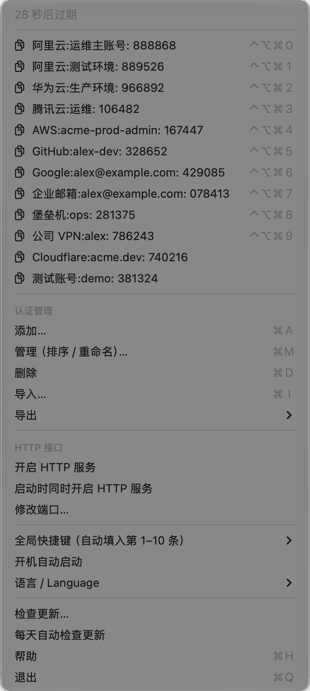
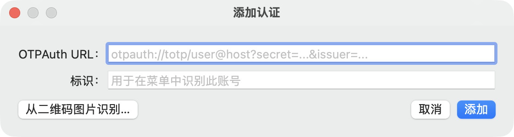
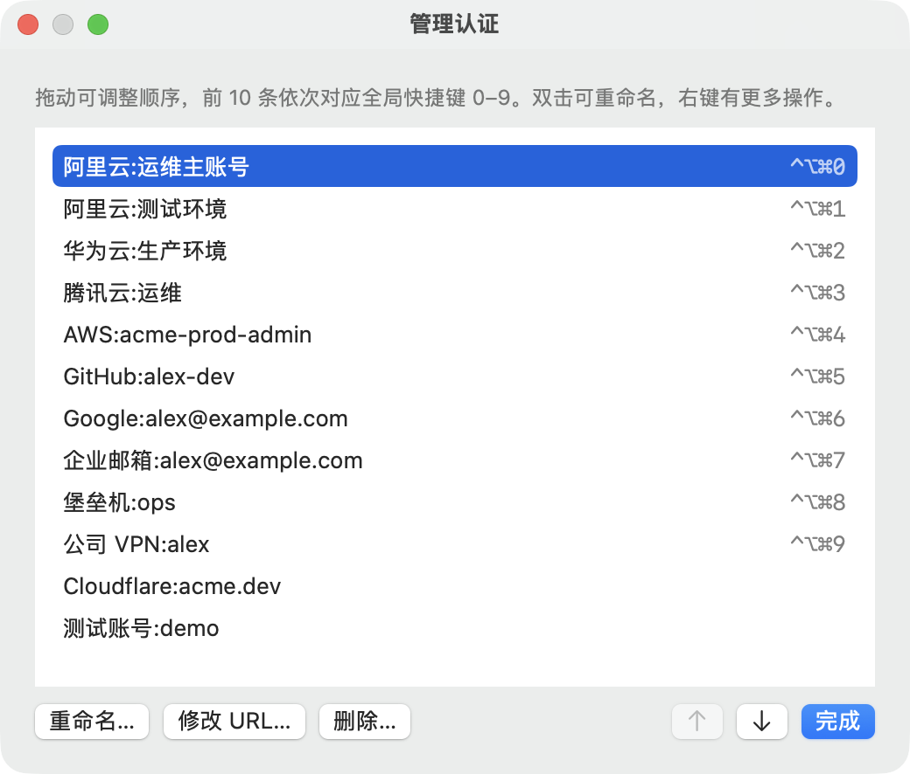
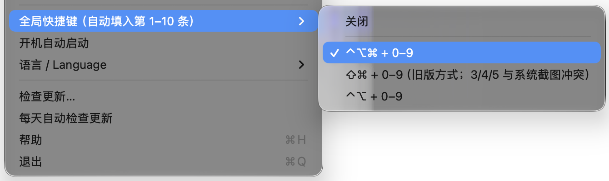
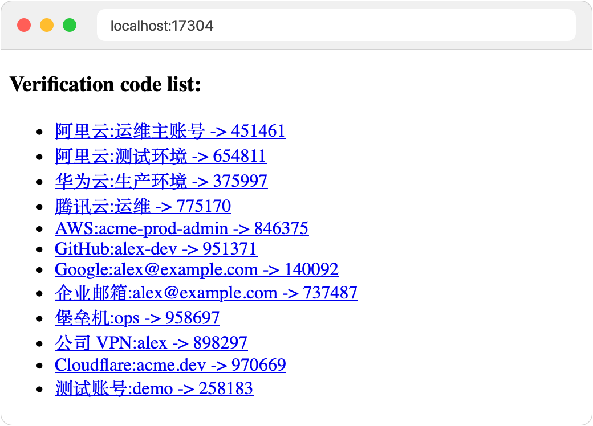

# GoldenPassport

[English](README.md) | 简体中文

macOS 菜单栏上的原生 Google Authenticator（谷歌身份验证器）。点一下菜单，或者按一个快捷键，就能拿到 TOTP 验证码。

> **这是 [stanzhai/GoldenPassport](https://github.com/stanzhai/GoldenPassport) 的维护分支（fork）。**
> 原项目从 2022 年起就没有更新了，Homebrew 也在 2026 年 9 月禁用了它的 cask。这里的 0.2 版本针对新版 macOS 从头重写，0.1.x 的用户可以直接覆盖升级：还是同一个 App、同一个数据目录，已有的账号会自动迁移。
> 最初的创意和设计都来自原作者 [StanZhai](https://github.com/stanzhai)，在此致谢。

- **Apple Silicon 原生运行**，也支持 Intel 芯片的 Mac，需要 macOS 13 或更高版本
- 使用 Developer ID 签名并经过 Apple 公证；不依赖任何第三方库
- 支持简体中文和英文界面：默认跟随系统语言，也可以在菜单「语言 / Language」里固定为简体中文或英文

# 截图

- [菜单栏菜单](#菜单栏菜单)
- [添加账号](#添加账号)
- [管理账号](#管理账号)
- [快捷键设置](#快捷键设置)
- [本地 HTTP 接口](#本地-http-接口)

### 菜单栏菜单

点击菜单栏上的钥匙图标。第一行是验证码刷新的倒计时。每个账号显示为「名称: 验证码」，点击即可复制验证码。前 10 个账号右侧标出了对应的全局快捷键。列表下方依次是认证管理、HTTP 接口、全局快捷键、开机自动启动和检查更新。



### 添加账号

选择「添加…」（⌘A），粘贴 `otpauth://` URL，或者点「从二维码图片识别…」选择一张二维码图片。标识会根据 URL 里的标签自动填写，添加前可以修改。



### 管理账号

「管理（排序 / 重命名）…」（⌘M）按菜单中的顺序列出所有账号。拖动或用上下箭头调整顺序，前 10 行会标出对应的快捷键。双击可以重命名；右键可以选择「重命名」「修改 URL」「删除」，底部也有同样的按钮。



### 快捷键设置

在「全局快捷键」子菜单里选择配合 0–9 使用的修饰键：⌃⌥⌘（默认）、⇧⌘（0.1.x 的方式，其中 3/4/5 和系统截图快捷键冲突）、⌃⌥，或者关闭。打勾的是当前设置。



### 本地 HTTP 接口

开启 HTTP 接口后，打开 `http://localhost:17304/` 会列出所有账号和当前的验证码。每一项都链接到 `/code/<名称>`，这个地址只返回纯文本的验证码，方便在脚本里使用。中文账号名可以正常显示。



# 0.2 有哪些变化

以下对比的是原版最后一个版本 0.1.7。每个版本的变化见[更新日志](CHANGELOG.zh-CN.md)。

0.2.1 修复了菜单栏图标只显示一个小人像的问题，不再允许同时运行两份 App，并把 Bundle ID 改为 `com.thatscode.GoldenPassport`。0.2.2 升级时会保留菜单栏图标原来的位置，图标不会因为菜单栏太挤而消失。从 0.2.3 起，「检查更新…」可以直接下载并安装新版本。

### 新功能

- **新图标**：按 macOS 26 的风格重画（金色钥匙，钥匙圈里是一个人像，延续原来的图标），菜单栏图标也随之更新，在各种尺寸下都清晰。macOS 13–15 显示它的扁平版本。
- **验证码按 otpauth URL 里的 TOTP 参数生成**：`algorithm`（SHA1、SHA256、SHA512）、`digits`（6–8 位）和 `period`。0.1.x 会忽略这些参数，一律生成 30 秒一换的 6 位 SHA1 验证码，参数不同的账号拿到的验证码是错的。
- **英文界面**：0.1.x 的菜单只有中文。新版默认跟随系统语言，也可以在菜单「语言 / Language」里固定为简体中文或英文。
- **管理窗口**（⌘M）：拖动或用上下箭头调整顺序，双击重命名，右键修改 URL 或删除（[#12](https://github.com/stanzhai/GoldenPassport/issues/12)、[#17](https://github.com/stanzhai/GoldenPassport/issues/17)、[#29](https://github.com/stanzhai/GoldenPassport/issues/29)）。
- **全局快捷键可配置**：⌃⌥⌘0–9（新的默认值）、⇧⌘0–9（0.1.x 的方式）、⌃⌥0–9，或者关闭。改为系统级注册，按键不会再同时传给当前 App（[#4](https://github.com/stanzhai/GoldenPassport/issues/4)、[#11](https://github.com/stanzhai/GoldenPassport/issues/11)、[#18](https://github.com/stanzhai/GoldenPassport/issues/18)）。
- **导出 otpauth URL 列表**（`.txt`），可以导入其他验证器 App。导入同时支持这种格式和 `.secrets` 备份文件（[#10](https://github.com/stanzhai/GoldenPassport/issues/10)、[#30](https://github.com/stanzhai/GoldenPassport/issues/30)）。
- **开机自动启动**开关。
- **检查更新**：「检查更新…」向 GitHub 查询有没有新版本，「每天自动检查更新」每天查询一次（默认关闭）。从 0.2.3 起，点「下载并安装」就能直接更新（见[更新](#更新)）。如果新版本会改变数据格式，或者需要先升级到某个中间版本，提示里会写明，并引导你改用 `install.sh`。
- 添加账号时，会根据 otpauth URL 里的标签自动填写标识；粘贴的 URL 会自动去掉首尾空白（[#26](https://github.com/stanzhai/GoldenPassport/issues/26)）。
- **带保护的安装脚本**：`install.sh` 会先备份 App 和数据，迁移后逐条核对账号，核对不通过就自动恢复到安装前的 App 和数据。`rollback.sh` 恢复安装前的 App，`cleanup.sh` 在不再需要回退时删除未加密的残留文件。脚本的提示语言和 App 的界面语言一致。
- **回退之后还能再升级回来**：回退期间在 0.1.x 里新增或修改的账号，再次升级时会列出来，由你选择要导入哪些。

### 问题修复

- 添加账号或识别二维码图片时闪退（[#1](https://github.com/stanzhai/GoldenPassport/issues/1)、[#16](https://github.com/stanzhai/GoldenPassport/issues/16)、[#21](https://github.com/stanzhai/GoldenPassport/issues/21)、[#22](https://github.com/stanzhai/GoldenPassport/issues/22)、[#25](https://github.com/stanzhai/GoldenPassport/issues/25)、[#28](https://github.com/stanzhai/GoldenPassport/issues/28)）。如果你仍然遇到，欢迎附上详情到[本仓库的 Issues](https://github.com/thatscode/GoldenPassport/issues) 反馈。
- 输入框里可以正常使用 ⌘V / ⌘C / ⌘A 了（[#9](https://github.com/stanzhai/GoldenPassport/issues/9)）。
- HTTP 页面声明了 UTF-8 编码，中文账号名不再乱码（[#26](https://github.com/stanzhai/GoldenPassport/issues/26)）。
- 重名时会提示，不再静默覆盖已有账号。
- 删除账号前会先确认。
- Bartender 等菜单栏管理工具可以识别 GoldenPassport 的图标了。

### 安全与隐私

- 账号存在**登录钥匙串**里，不再写明文文件。别的程序要读取时，系统会先弹框问你；清理掉旧的数据文件之后，数据目录被拷走、被同步工具带走，或出现在安装备份、未加密的时间机器备份里，都不会再带出密钥。
- 正式版使用 **Developer ID 签名并经过 Apple 公证**：下载后可以直接打开，不用绕过 Gatekeeper；同一个开发者签名的后续更新可以直接读取钥匙串里的账号，不会再次询问。
- 全新安装时 HTTP 接口默认关闭。它没有访问密码，开启期间，这台 Mac 上以你的身份运行的任何程序都能读取全部验证码。从 0.1.x 升级的用户保持原来的设置。
- GoldenPassport 只在检查更新时联网，而且只在你要求时才检查：点「检查更新…」，或者打开「每天自动检查更新」（默认关闭）。检查时会向 GitHub 的接口查询最新版本；如果比当前版本新，还会下载这个版本附带的一个兼容性说明小文件。请求只以 `GoldenPassport/<版本号>` 标识自己，不带 Cookie，也不带任何账号信息。只有点了「下载并安装」才会下载新版本，而且只有确认它由同一个 Developer ID 签名、并经过 Apple 公证，才会安装。
- HTTP 接口只监听 127.0.0.1，并拒绝 `Host` 头不是本机的请求（[#6](https://github.com/stanzhai/GoldenPassport/issues/6)），网页无法通过 DNS 重绑定读取你的验证码。
- 数据文件仅本人可读：数据目录权限为 `0700`，文件为 `0600`。0.1.x 的文件本机所有用户都能读，0.2.0 会收紧已有文件的权限，但不改动文件内容。
- 两种导出格式在导出前都会提示：文件里是未加密的全部密钥。
- 密钥副本可能存在的所有位置，见[数据与安全](#数据与安全)。

### 需要注意的行为变化

| | 0.1.x | 0.2.0 |
|---|---|---|
| 最低系统版本 | 10.10 | **13** |
| 默认快捷键 | ⇧⌘0–9（3/4/5 和系统截图冲突） | **⌃⌥⌘0–9**；仍可在菜单里切换回 ⇧⌘ |
| 自动填入验证码 | 需要辅助功能权限 | 仍然需要，而且升级后要**重新授权** |
| 启动时开启 HTTP 接口 | 默认开启，可以手动关闭 | **全新安装默认关闭**；升级的用户保持 0.1.x 里的设置 |
| 账号存放位置 | `gp.secrets` | 登录钥匙串。自动迁移；`gp.secrets` 会保留，但之后不再更新 |
| 账号顺序 | 每次启动都可能变化 | 迁移后按名称排序，之后按你调整的顺序 |

# 安装

正式版使用 Developer ID 签名并经过 Apple 公证，下载后可以像其他 App 一样直接打开。

> [!NOTE]
> Homebrew 上的 cask（`brew install --cask goldenpassport`）指向的仍是旧版 0.1.7，而且已被 Homebrew 禁用。恢复 Homebrew cask 在[后续计划](#后续计划)中。

### 更新

从 0.2.3 起，「检查更新…」发现新版本后，点「下载并安装」，GoldenPassport 会依次：

1. 从 GitHub 下载新版本；
2. 确认下载的正是提示的版本，由同一个 Developer ID 签名，并经过 Apple 公证；
3. 确认新版本能读取你的账号（系统可能会询问一次是否允许访问钥匙串，请选「**始终允许**」）；
4. 把当前版本移到废纸篓，换上新版本并打开。

账号、设置、「开机自动启动」和辅助功能授权都会保留：只有 App 的签名身份或 Bundle ID 变化时，系统才会要求重新授权辅助功能。万一授权没有保留，更新完成的提示里会说明，并提供打开设置的按钮。

任何一步没通过，都不做任何改动，你会继续使用当前版本。想退回去的话，先退出 GoldenPassport，把新版本从「应用程序」里移走，再把旧版本从废纸篓放回去。

只有能安全完成时才会提供这个按钮。下面几种情况会引导你到发布页面，改用会先做备份的 `install.sh`：新版本会改变数据格式或需要先升级到中间版本；GoldenPassport 运行的位置不能直接替换（比如直接从「下载」文件夹打开，请先把它移到「应用程序」）；当前账号没有权限修改它。0.2.2 及更早的版本没有这个按钮，需要按下面的方法安装一次 0.2.3。

### 从 0.1.x 升级，或全新安装（推荐）

1. 从[最新的 Release](https://github.com/thatscode/GoldenPassport/releases/latest) 下载 `GoldenPassport-<版本号>.zip` 并解压。解压出的文件夹里有 App、`install.sh`、`rollback.sh`、`cleanup.sh` 和安装说明（`安装说明.md`、`INSTALL.md`）。
2. 打开「终端」，输入 `bash `（注意后面有一个空格），把解压出来的 `install.sh` 拖进终端窗口，按回车。

如果想自己从源码构建，见[从源码构建](#从源码构建)。

安装脚本会依次：

1. 检查安装包是否完整，以及是否支持你的 Mac 和系统版本；
2. 把当前的 App 和数据备份到 `~/GoldenPassport-backups/<时间>/`（⚠️ 备份里是未加密的密钥，见[数据与安全](#数据与安全)）；
3. 退出正在运行的旧版，把新版安装到「应用程序」；
4. 把账号迁移到登录钥匙串，并和原来的数据文件（`gp.secrets`，或 0.2.0 内测版的 `accounts.json`）逐条核对，过程中只显示账号名称。**如果有任何一条不一致，会自动恢复到安装前的 App 和数据**；
5. 启动 GoldenPassport。

从 0.1.x、0.2.0 或 0.2.0 内测版升级之后，如果希望快捷键自动填入验证码，需要重新授权**辅助功能**：系统设置 → 隐私与安全性 → 辅助功能。如果列表里已经有 GoldenPassport，但按快捷键不会自动填入，先用「−」把它删掉，再到菜单里重新选一次快捷键，系统就会重新请求授权。没授权时，按快捷键会把验证码复制到剪贴板。从 0.2.0 升级时，系统还会询问一次是否允许 GoldenPassport 使用钥匙串（请选「**始终允许**」），**开机自动启动**也要重新打开：0.2.1 换了 Bundle ID。

### 回退

用同样的方式运行 `rollback.sh`，就会恢复安装前的 App。0.1.x 和 0.2.0 内测版不使用钥匙串，它们看到的是 0.2.x 迁移那一刻的账号（`gp.secrets` 本身从未被修改）。如果要带上之后的改动，先在 0.2.x 里导出 `.secrets` 备份文件，回退后再导入。

再次升级后，0.2.x 继续使用钥匙串里的账号。回退期间在 0.1.x 里新增或修改的账号会列出来，由你选择要导入哪些；已有的账号不会被覆盖或删除，改过 URL 的账号会以「名称 (0.1.x)」导入，和原来的账号并存。在内测版里做的改动不会自动带过去，`cleanup.sh` 删除内测版的 `accounts.json` 前会列出它们。

`rollback.sh --restore-data` 会把数据目录也恢复到安装前，在 0.2.x 里做的改动随之丢失：再次安装 0.2.x 时会从恢复的旧文件重新迁移，原来钥匙串里的账号只作为备用条目 `accounts.replaced-<时间>` 保留。

### 升级后的清理

确认 0.2.x 使用正常、不再需要回退后，用同样的方式运行 `cleanup.sh`。脚本会先确认钥匙串里的账号读取正常，再列出要删除的内容：安装备份和旧的数据文件（`gp.secrets`、内测版的 `accounts.json`），这些都含有未加密的密钥；0.1.x 的 `config.plist` 也会一并删除。如果有账号只存在于这些文件里，会额外提醒。输入 `yes` 后才会删除；清理之后，就不能再回退了。

安装包里的安装说明（`安装说明.md`，也可以[在线查看](docs/install.zh-CN.md)）一步步介绍了安装、回退和清理。

### 手动安装

把 `GoldenPassport.app` 复制到「应用程序」，然后打开它。首次启动时会自动迁移数据，但手动安装没有备份，也没有迁移核对。

# 使用

点击菜单栏上的钥匙图标，每个账号后面就是当前的验证码，点一下即可复制。

| 菜单项 | 作用 |
|---|---|
| 添加…（⌘A） | 通过 otpauth URL 或二维码图片添加账号 |
| 管理（排序 / 重命名）…（⌘M） | 调整顺序、重命名、修改 URL、删除账号 |
| 删除（⌘D） | 删除账号，删除前会确认 |
| 导入…（⌘I） | 导入 `.secrets` 备份文件或 otpauth URL 列表；已存在的名称会跳过 |
| 导出 → 备份文件（.secrets） | 新旧版本都能导入的备份 |
| 导出 → otpauth URL 列表（.txt） | 每个账号一行 otpauth URL，可导入其他验证器 App |
| HTTP 接口 | 开启或停止本地接口、设置随启动开启、在浏览器中打开、修改端口 |
| 全局快捷键 | 选择快捷键的修饰键，或者关闭 |
| 开机自动启动 | 登录时自动启动 GoldenPassport |
| 语言 / Language | 跟随系统，或固定使用简体中文 / English（切换后会重启 App） |
| 检查更新… | 立即向 GitHub 查询有没有新版本；从 0.2.3 起可以直接下载并安装 |
| 每天自动检查更新 | 每天查询一次，有新版本时显示在菜单最上方（默认关闭） |
| 帮助（⌘H） | 在 GitHub 上打开这份说明，语言和菜单一致 |

### 全局快捷键

修饰键 + **0** 填入列表中**第 1 个**账号的验证码，修饰键 + **1** 是第 2 个，依此类推，**9** 对应第 10 个。在管理窗口里调整顺序，就能决定哪些账号有快捷键。

### RESTful API

开启后，GoldenPassport 会在 `http://localhost:17304/` 上提供验证码（端口可以在菜单里修改），只监听 127.0.0.1。全新安装时这个接口默认关闭：用「开启 HTTP 服务」打开；勾选「启动时同时开启 HTTP 服务」后，每次启动 App 时会自动开启。

| 接口 | 返回内容 |
|---|---|
| `GET /` | 列出所有账号的 HTML 页面，每个账号链接到它的验证码 |
| `GET /code/<账号名称>` | 纯文本格式的当前验证码；没有这个账号时返回 `404` |

```sh
code=$(curl -s 'http://localhost:17304/code/test@stanzhai.site')
echo "$code"
```

# 数据与安全

> [!CAUTION]
> **升级后，磁盘上会留有未加密的 MFA 密钥副本。**
>
> - **安装脚本的备份**：`install.sh` 会把整个数据目录复制到 `~/GoldenPassport-backups/<时间>/`，用于回退。这是全部密钥的明文副本（权限为仅本人可读）。不要分享或同步它，确认不再需要回退后请删除（用 `cleanup.sh`，见[升级后的清理](#升级后的清理)）。
> - **旧版数据文件**：迁移后 `gp.secrets` 会保留在数据目录里，旧版才能继续使用。它之后不再更新，所以**你在 0.2.x 里删除的账号，密钥仍然留在这个文件里**。确定不会再回到 0.1.x 后，请删除它（用 `cleanup.sh`）。
> - **内测版的数据文件**：0.2.0 把账号迁移到钥匙串后，内测版的 `accounts.json` 仍以明文留在数据目录里，供回退使用。确定不会再回到内测版后，请删除它（用 `cleanup.sh`）。
> - **导出文件**：`.secrets` 和 `.txt` 两种导出文件都包含未加密的全部密钥。

GoldenPassport 把账号列表存在登录钥匙串里一个名为 **GoldenPassport** 的条目中。它只存在这台 Mac 上（不通过 iCloud 钥匙串同步），别的程序要读取时系统会先弹框询问。钥匙串不改变 HTTP 接口和导出文件：接口开启期间，以你的身份运行的任何程序仍然能读取全部验证码，导出文件仍然是明文。

数据目录 `~/Library/Application Support/GoldenPassport/` 只有你本人能读：0.2.0 会把目录权限设为 `0700`、文件设为 `0600`（0.1.x 的文件本机所有用户都能读）。除了上面列出的旧数据文件，这里没有密钥：`accounts-v2.json` 只说明账号存在钥匙串里，`settings.json` 保存设置，`legacy-baseline.json` 记录 `gp.secrets` 里有哪些账号（只有名称和 URL 的指纹，不含密钥），用来发现回退期间在 0.1.x 里做的改动。

### GoldenPassport 无法读取数据时

如果数据文件读不出来（比如文件损坏了，或者被手动改过），GoldenPassport 会弹出提示、写明是哪个文件，然后退出，不会改动任何文件。它不会带着空列表启动，否则下次保存时就会覆盖原来的数据。恢复时的操作都在数据目录里进行（在提示框里点「在 Finder 中显示」，或者打开 `~/Library/Application Support/GoldenPassport/`）。

如果提示里写的是 **`accounts-v2.json`**，你的账号仍然在钥匙串里：

1. 把 `accounts-v2.json` 改个名字，例如 `accounts-v2.damaged.json`。
2. 数据目录里如果有 `gp.secrets` 或 `accounts.json`，先把它们暂时移出去。否则 GoldenPassport 会用这些旧文件重建列表，钥匙串里现在的账号只会作为备用条目（`accounts.replaced-<时间>`）保留。
3. 启动 GoldenPassport。它会找到钥匙串里的账号，并重新写一份 `accounts-v2.json`。如果还想保留回退的可能，之后再把移出去的文件放回来。

如果提示里写的是 **`accounts.json`**（自己构建的版本和 0.2.0 内测版的数据文件）：

1. **保留损坏的文件**：给它改个名字，例如 `accounts.damaged.json`，不要删除。
2. **如果有 `accounts.json` 的备份**，把它复制回数据目录，再启动 GoldenPassport。备份可以来自时间机器（Time Machine），也可以来自 `~/GoldenPassport-backups/<时间>/data/`：如果你在已经装了 0.2.x 的情况下运行过 `install.sh`，那里保存着那次安装时的账号。
3. **如果只有导出文件**（`.secrets` 或 `.txt`）：数据目录里如果有 `gp.secrets`，先把它也暂时移出去。然后启动 GoldenPassport（这时列表是空的），导入导出文件。如果还想保留回退到 0.1.x 的可能，导入后再把 `gp.secrets` 放回去。不先移走的话，GoldenPassport 会先用 `gp.secrets` 重建列表（也就是你从 0.1.x 升级那一刻的账号），而导入会跳过所有同名的账号，留下的就是这些旧记录。
4. **如果两者都没有**，但数据目录里还有 `gp.secrets`：做完第 1 步后直接启动 GoldenPassport。它会用 `gp.secrets` 重建列表，恢复到你从 0.1.x 升级那一刻的账号；之后新增或修改的账号，用这个方法找不回来。

如果提示里写的是 `gp.secrets`，说明 0.1.x 的数据文件损坏了，里面的账号无法迁移。把它移出数据目录，再按上面的方法用备份或导出文件恢复。

#### 钥匙串里的账号读不出来时

提示框里会说明原因，不会改动任何数据：

- **没有获得授权**：系统询问时你点了「拒绝」。点「重试」，再选「始终允许」。更新后如果 macOS 识别 App 的方式变了（换了签名的开发者，或者换了 Bundle ID，例如 0.2.1），系统会再问一次。
- **钥匙串已锁定**：在「钥匙串访问」里解锁「登录」钥匙串，再点「重试」。
- **条目不见了**（在「钥匙串访问」里被删除了，或者只把数据目录拷到了这台 Mac）：数据目录里还有 `accounts.json` 或 `gp.secrets` 时，可以选择从它重新迁移。那是迁移到钥匙串之前的账号，如果有更新的导出文件，迁移后再导入它。没有这样的文件时，可以从空列表开始，再导入导出文件；也可以退出，从备份恢复登录钥匙串。
- **数据来自更新的版本**：重新安装那个版本。

迁移时如果钥匙串里已经有旧的 GoldenPassport 条目（例如执行过 `rollback.sh --restore-data`），会把它另存为 `accounts.replaced-<时间>`，不会覆盖。不再需要时，可以在「钥匙串访问」里删除这些条目。

到 [Issues](https://github.com/thatscode/GoldenPassport/issues) 里求助时，可以附上提示框里的文字，但**不要附带数据文件**，里面有你的密钥。

如果发现的是安全问题，请不要公开提 issue，而是通过 [Report a vulnerability](https://github.com/thatscode/GoldenPassport/security/advisories/new) 私下告诉维护者。

# 从源码构建

需要 Xcode 16 或更高版本，不依赖第三方库。

```
make test      # 单元测试
make check     # 在本机跑一遍 CI 的检查：单元测试，再构建通用版预发布包，在临时目录里检查并安装
make dev       # 「GoldenPassport Dev.app」：独立的 Bundle ID、数据目录和端口 17305，快捷键默认关闭
make run-dev   # 构建并启动开发版
make release   # 「GoldenPassport.app」，可直接替换已安装的正式版
make package   # 通用版 App + 安装、回退、清理脚本 + 安装说明，打包为 zip，放在 dist/ 目录
make beta      # 同上，标为预发布版
```

构建产物输出到 `~/Library/Caches/GoldenPassport-build/<variant>/`。构建出的 App 使用 ad-hoc 签名并启用 Hardened Runtime，账号以明文存在数据目录的 `accounts.json` 里：系统把每个 ad-hoc 构建都当成新的程序，每次更新后都会重新询问钥匙串授权。设置 `SIGN_IDENTITY="Developer ID Application: …"` 会用证书签名，同时启用钥匙串存储（也可以单独设置 `KEYCHAIN=1`）；配合 `make package` 再设置 `NOTARIZE=1`，会提交 Apple 公证并装订公证票据（`scripts/notarize.sh`）。`ARCHS="arm64 x86_64"` 可以构建通用版。

开发版首次启动时，如果正式版的数据目录里有 0.1.x 的数据（`gp.secrets`、`config.plist`），会把它复制到 `GoldenPassport-Dev/`；开发版从不写入正式版的数据目录，所以可以和已安装的正式版同时运行。这份副本是明文的密钥，用完请删除 `GoldenPassport-Dev/`。`GoldenPassport --migrate-data [--data-dir PATH]` 可以在不打开界面的情况下执行数据迁移并核对结果，`install.sh` 就是靠它完成核对的。`GP_KEYCHAIN_TESTS=1 make test` 会额外运行读写真实登录钥匙串的测试（使用临时条目）。

# 后续计划

- 恢复 Homebrew cask

# 致谢与协议

GoldenPassport 由 [StanZhai](https://github.com/stanzhai) 于 2017 年创建，本 fork 由 [thatscode](https://github.com/thatscode) 维护。

本项目采用 [MIT 协议](LICENSE)，继承自原项目（[stanzhai/GoldenPassport#33](https://github.com/stanzhai/GoldenPassport/issues/33)）；原仓库现已归档。

# 参考资料

- [RFC 6238：TOTP](https://www.rfc-editor.org/rfc/rfc6238)
- [Key URI 格式（otpauth://）](https://github.com/google/google-authenticator/wiki/Key-Uri-Format)
- [google-authenticator](https://github.com/google/google-authenticator)
